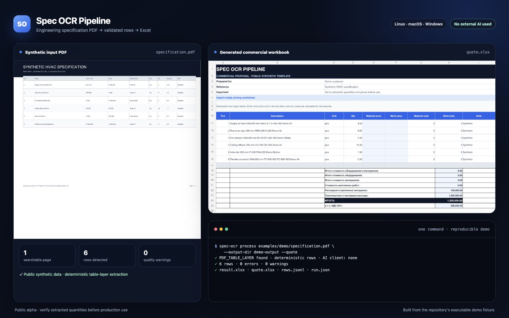

# Spec OCR Pipeline

[English](README.md) | [Русский](README.ru.md)

[](https://github.com/floze-the-genius/spec-ocr-pipeline/actions/workflows/ci.yml)
[](pyproject.toml)
[](LICENSE)

Spec OCR Pipeline is a cross-platform command-line tool that turns engineering specification PDFs
into inspectable normalized rows and editable Excel workbooks. It provides a deterministic,
local-only path for supported searchable PDFs, system Tesseract integration for scans, and optional
local or external AI providers for harder layouts.

> **Public alpha:** the core workflow is usable and tested, but provider setup, command options, and
> output details may still change. OCR and AI results are drafts: always review quantities, units,
> row boundaries, totals, and workbook formulas before operational use.



## What it produces

- normalized JSONL that is easy to inspect, diff, and process;
- a clean single-sheet XLSX workbook;
- an optional template-based commercial proposal workbook;
- OCR, quality, performance, and run metadata for traceability;
- explicit provider choices so local and external data paths are visible.

The bundled demo is synthetic and safe to publish. Real-world layouts vary, and a successful run is
not a guarantee that every extracted value is correct.

## Quick start

Copy the HTTPS or SSH URL from GitHub's **Code** menu, then clone the repository:

```bash
git clone https://github.com/floze-the-genius/spec-ocr-pipeline.git
cd spec-ocr-pipeline
```

Create and activate a virtual environment.

Linux or macOS:

```bash
python -m venv .venv
source .venv/bin/activate
```

Windows PowerShell:

```powershell
python -m venv .venv
& .\.venv\Scripts\Activate.ps1
```

Install the OCR-enabled user environment:

```bash
python -m pip install -e ".[ocr]"
```

Contributors should install the development environment instead:

```bash
python -m pip install -e ".[dev]"
```

Run the one-command synthetic demo from the repository root:

```bash
spec-ocr process examples/demo/specification.pdf --output-dir demo-output --quote
```

This demo follows the searchable-PDF path and does **not** call an external AI service. It creates:

| File | Purpose |
| --- | --- |
| `demo-output/ocr.json` | Extracted page text, tokens, metadata, and provider information |
| `demo-output/rows.jsonl` | Normalized, reviewable specification rows |
| `demo-output/result.xlsx` | Editable single-sheet Excel workbook |
| `demo-output/quote.xlsx` | Template-based commercial proposal workbook |
| `demo-output/run.json` | Run version, inputs, options, output names, and external-AI flag |

The command refuses to overwrite existing outputs unless you explicitly add `--force`. The safe
one-command path supports searchable PDFs with a recognized table layer; scanned or more complex
documents require an explicit provider workflow described in [Usage](docs/usage.md).

## Platform support

| Capability | Linux | macOS | Windows |
| --- | --- | --- | --- |
| Core searchable PDF / Excel workflow | Native | Native | Native |
| Tesseract OCR | System binary | System binary | System binary |
| Local AI | x86_64 + NVIDIA | Apple Silicon + MLX | x64 + WSL2 + NVIDIA |

Python 3.11–3.14 is required. The Tesseract executable and language packs are installed through
the operating system and are not bundled. Intel Mac local AI, Windows ARM, and native-Windows CUDA
are unverified; this is not a support claim for those combinations.

See the platform-specific instructions for details:

- [Linux installation](docs/installation/linux.md)
- [macOS installation](docs/installation/macos.md)
- [Windows installation](docs/installation/windows.md)

## Providers and privacy

The core searchable-PDF path and system Tesseract run locally. Optional mapping providers may be
local or external. An external AI provider can receive OCR text and, when enabled, page images.
Review [Providers](docs/providers.md) and [Privacy](docs/privacy.md) before processing real documents.
AI mapping is fail-closed by default: `map-ocr` requires an explicit `--ai-client` when no supported
deterministic table layer is available.

Authenticate only with your own provider account inside your own environment. Never commit,
publish, request, or share API keys, OpenCode/browser sessions, refresh tokens, cookies, `.env`
files, or exported authentication state. Do not attach real documents or derived OCR/workbook data
to public issues.

## Documentation

- Installation: [Linux](docs/installation/linux.md), [macOS](docs/installation/macos.md),
  [Windows](docs/installation/windows.md)
- [Usage guide](docs/usage.md)
- [OCR and AI providers](docs/providers.md)
- [Privacy and credentials](docs/privacy.md)
- [Architecture](docs/architecture.md)
- [Troubleshooting](docs/troubleshooting.md)
- [Release process](docs/releasing.md)
- [Contributing](CONTRIBUTING.md)
- [Security policy](SECURITY.md)
- [Support](SUPPORT.md)
- [Changelog](CHANGELOG.md)
- [MIT License](LICENSE)

## Development

After installing `.[dev]`, run:

```bash
python -m ruff check src tests scripts
python -m ruff format --check src tests scripts
python -m pytest
python scripts/check_public_tree.py
```

The CI workflow exercises supported Python versions on Linux, macOS, and Windows and validates the
built package. Hardware-specific OCR and AI runtimes still require testing on the corresponding
machine; state untested combinations honestly in pull requests.

Contributions are welcome, especially focused fixes with synthetic fixtures, regression tests, and
clear platform results. Read [CONTRIBUTING.md](CONTRIBUTING.md) before opening a pull request, and
use the private process in [SECURITY.md](SECURITY.md) for vulnerabilities.

## License

Spec OCR Pipeline is available under the [MIT License](LICENSE).
