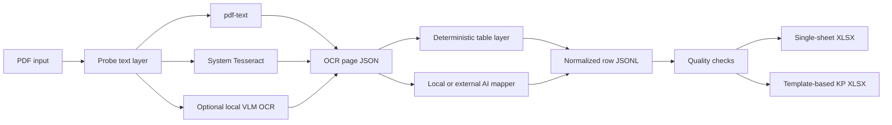

# Architecture

The pipeline keeps extraction, semantic mapping, validation, and export as separate stages. JSON
and JSONL boundaries make each stage inspectable and allow a local-only workflow when providers
are configured accordingly.

## Stages

1. **Probe and extraction.** The CLI inspects a PDF and invokes an explicit OCR provider. The
   result records page text, token geometry where available, metadata, and provider provenance.
2. **Mapping.** A deterministic `PDF_TABLE_LAYER` can be mapped without AI. Other layouts can be
   mapped with Apple Silicon MLX, a local OpenAI-compatible server, or an explicitly configured
   external provider.
3. **Normalization and quality.** Provider output is converted to a stable row schema and checked
   for structural and content warnings. A quality gate can turn findings into a nonzero exit.
4. **Export.** JSONL is the reviewable interchange format; XLSX exporters create the delivery
   formats.

The main package areas mirror these responsibilities:

- `spec_pipeline.ocr` contains page rendering and OCR provider adapters.
- `spec_pipeline.ai` contains mapping clients and prompt/data-boundary logic.
- `spec_pipeline.models` contains normalized domain records.
- `spec_pipeline.exporters` contains XLSX output logic.
- `spec_pipeline.workflows` composes reusable operations.
- `spec_pipeline.cli` exposes the command-line interface and diagnostics.

## Data and trust boundaries

The source PDF, rendered page images, OCR JSON, normalized JSONL, prompt material, quality reports,
model caches, and workbooks are separate persisted assets. A deployment should give each an owner,
retention period, and access policy.

The most important trust boundary is between local files and a mapping or OCR provider. Provider
names alone are not a security control: an OpenAI-compatible URL may be loopback or remote, and an
OpenCode profile may resolve to an external account. Log the resolved provider category without
logging credentials or document contents.

## Platform boundary

The deterministic searchable-PDF and Excel path is native on Linux, macOS, and Windows. Tesseract
is an operating-system dependency. Supported local AI is limited to Apple Silicon MLX, Linux
x86_64 NVIDIA, and Windows x64 through WSL2 NVIDIA. See [Providers](providers.md) for the full
contract.

## Failure model

No OCR or AI output should be accepted solely because the command exited successfully. Operational
use requires a quality report, review of row counts and totals, inspection of warnings, and a
human check of the resulting workbook. External provider timeouts and partial batches must fail
visibly rather than silently producing an apparently complete workbook.
